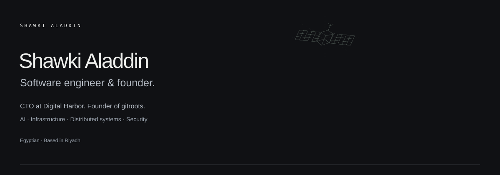

<picture>
  
</picture>

### About

I build backend systems, developer tools, and infrastructure. My interests include applied AI, cybersecurity, and space systems.

### Projects

| Project | Focus |
| :--- | :--- |
| [gitroots](https://gitroots.com) | Code governance and access controls for engineering teams. |
| [CryptoRadar](https://cryptorader.io) | A crypto platform in development. |

### Research

[**Satellite Repair Lab**](https://github.com/shawkialaddin/satellite-repair-lab) is an ongoing experimental testbed for offline vulnerability repair and independent patch acceptance in satellite-inspired applications.

The current prototype evaluates handwritten candidates against synthetic fixtures. AI-generated repair and spacecraft integration have not been evaluated. The longer-term research direction includes autonomous repair agents.

### Interests

Applied AI · Cybersecurity · Distributed systems · Space technology

[Personal page](https://shawkialaddin.github.io/shawkialaddin/) · [Research repository](https://github.com/shawkialaddin/satellite-repair-lab) · [ORCID](https://orcid.org/0009-0000-0053-0608)

The personal page contains the automatic pixel portrait, public GitHub contribution calendar, and interactive experiments. Its [source and setup](SITE.md) live in this repository.
