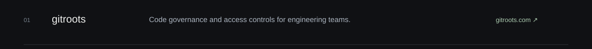
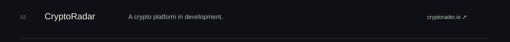
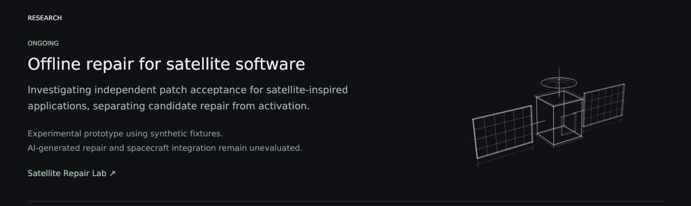
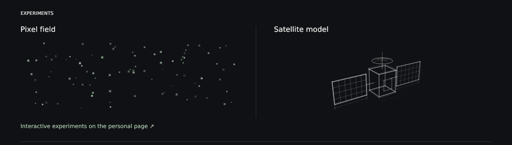

[Personal page](https://shawkialaddin.github.io/shawkialaddin/) · [Research](https://github.com/shawkialaddin/satellite-repair-lab) · [ORCID](https://orcid.org/0009-0000-0053-0608) · [Source](SITE.md)
