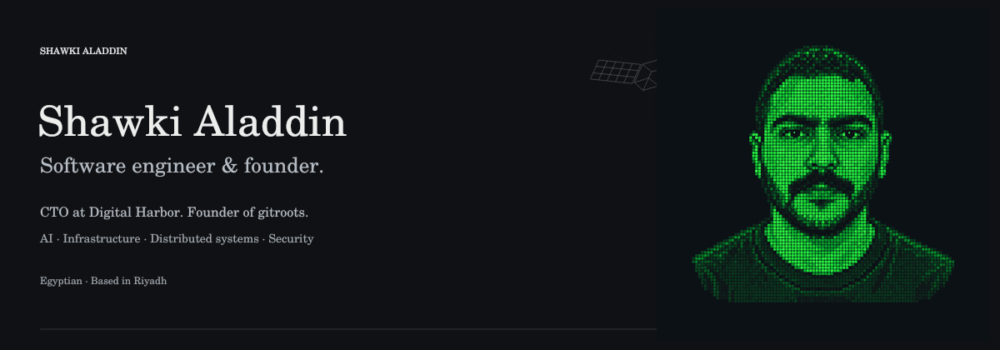
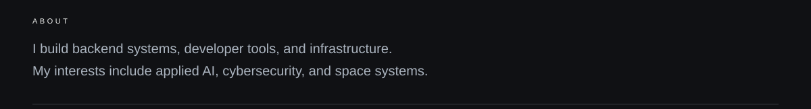
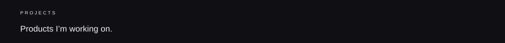
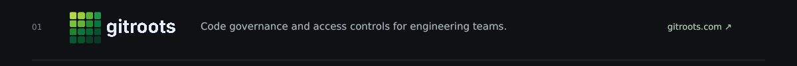
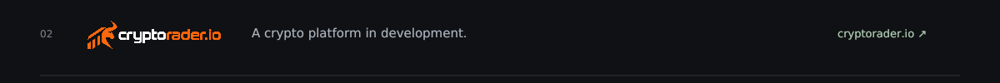
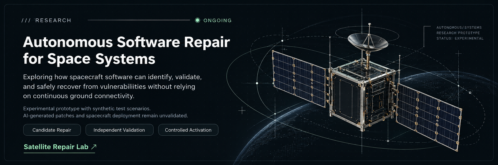
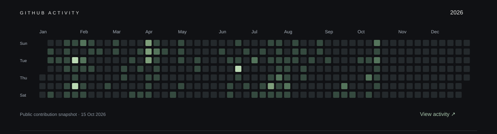
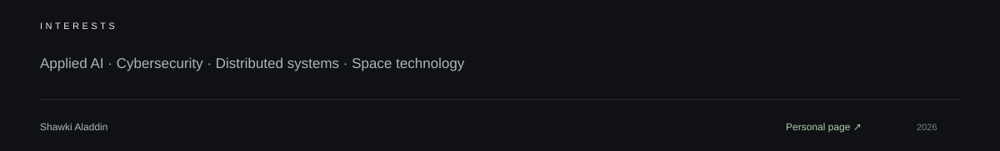

<a href="https://zenodo.org/uploads/23406773">Research on Zenodo ↗</a> · <a href="https://github.com/shawkialaddin/satellite-repair-lab">Source code ↗</a>

[Personal page](https://shawkialaddin.github.io/shawkialaddin/) · [Research](https://github.com/shawkialaddin/satellite-repair-lab) · [ORCID](https://orcid.org/0009-0000-0053-0608) · [Source](SITE.md)
